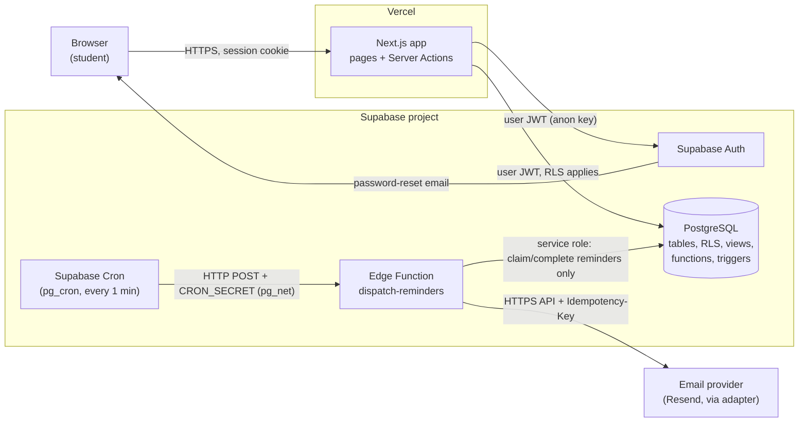
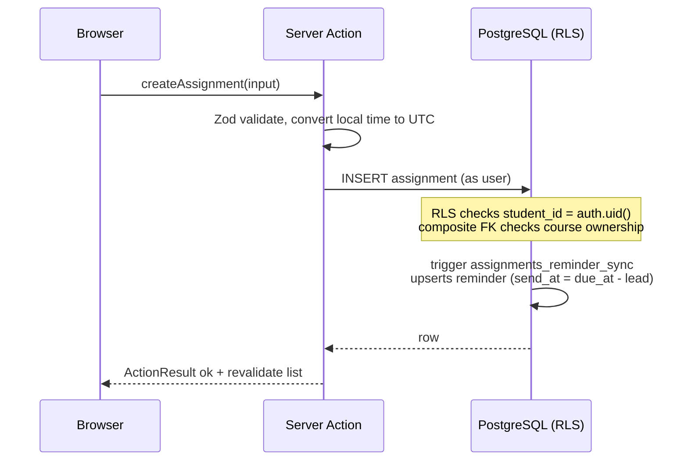
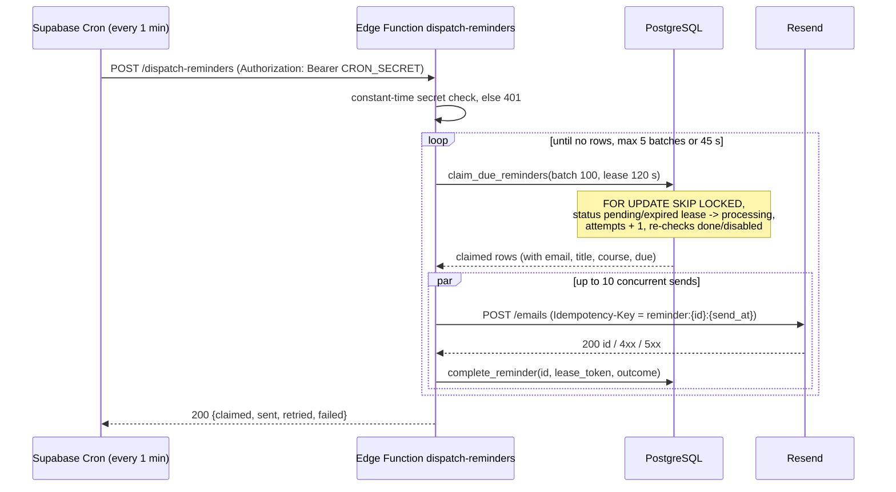

# Consolidated Architecture: Student Task Tracker

**Status**: Consolidated (Lab 7, step 7)
**Date**: 2026-11-05
**Decision**: [docs/decision.md](../decision.md): alternative serverless architecture, accepted with conditions
**Requirements**: [requirements.md](./requirements.md) · **Design**: [design.md](./design.md)
**Sources**: [alternative architecture](../architecture-alternative.md) (baseline) ·
[base plan](../../specs/001-student-task-tracker/plan.md) ·
[base review](../reviews/review-base.md) · [alternative review](../reviews/review-alternative.md)

> **Launch gates (open):** **G-1** Principle IV processor approval
> ([requirements §6](./requirements.md#6-privacy-security-and-governance-requirements)) ·
> **G-2** measured SC-003 reminder evidence ([§6.5](#65-proving-sc-003)).
> This architecture is **not** claimed to be fully constitution-compliant until G-1 is closed.

---

## 1. Context, Goals and Non-Goals

**Context.** A small team builds a web app for students to track coursework and get deadline
reminders. Expected scale: up to 10,000 registered and 1,000 concurrently active students, and up to
about 1,000 reminders per hour at peak.

**Goals.**
1. Deliver all FR-001 to FR-020 with the least infrastructure to operate.
2. Enforce per-student data isolation in the database (RLS), not only in application code.
3. Send reminders with measurable timing margin against SC-003 (99 % within 5 minutes).
4. Keep data portable (standard PostgreSQL) and keep the email provider replaceable.

**Non-goals (v1).** A public or mobile REST API; SSO; push/SMS; sharing; LMS integration;
multi-region deployment.

## 2. Architecture at a Glance



**What changed from the alternative baseline:** the reminder schedule moved from **Vercel Cron
every 5 minutes** to **Supabase Cron every minute** calling a **Supabase Edge Function**. This is
because Vercel Hobby crons run at most once a day with ±59 min precision (requirements D-1). It
also keeps the service-role key inside Supabase, so the Next.js app never holds it.

## 3. Components

| Component | Runs on | Responsibility | Credential it holds |
|-----------|---------|----------------|---------------------|
| **Next.js pages** | Vercel | Server-rendered dashboard, course, calendar, settings and auth pages; small client components for forms, filters and calendar navigation | None in the browser except the public anon key |
| **Server Actions** | Vercel (server) | All mutations and reads that need validation; call Supabase with the **signed-in user's JWT** so RLS applies | Supabase URL + anon key (public) |
| **Domain modules** (`lib/domain/*`) | Vercel (server) | Pure, unit-tested rules: time-zone conversion, `send_at` calculation, input schemas, error mapping | None |
| **Supabase Auth** | Supabase | Registration, sign-in/out, sessions, password reset email, rate limiting | — |
| **PostgreSQL** | Supabase | System of record; tables, constraints, **RLS on every table**, views (`assignments_view`, `course_averages`), functions (`claim_due_reminders`, `complete_reminder`, `reschedule_student_reminders`, `delete_my_account`), triggers that keep reminders in sync | — |
| **Supabase Cron** | Supabase (pg_cron + pg_net) | Every minute: POST to `dispatch-reminders`. Daily: reconciliation and retention cleanup jobs | `CRON_SECRET` in Supabase Vault |
| **Edge Function `dispatch-reminders`** | Supabase | Verify secret → claim a batch of due reminders → re-check → send through the adapter → record the result | **Service-role key** (only here), `RESEND_API_KEY`, `CRON_SECRET` |
| **Email adapter** | Inside the Edge Function | `sendReminder({to, subject, html, idempotencyKey})`; maps provider errors to retryable/permanent | `RESEND_API_KEY` |
| **Email provider (Resend)** | External | Delivers reminder emails | — |

### Layering (kept from the base architecture)

```text
Presentation   app/(pages), components/          ← no SQL, no business rules
Application    app/actions/*.ts (Server Actions) ← validate, authorize, call data layer
Domain         lib/domain/*.ts                   ← pure functions, unit tested
Persistence    supabase/migrations/*.sql         ← schema, RLS, views, functions, triggers
Integration    supabase/functions/dispatch-reminders/, lib/email/adapter.ts
```

## 4. Key Flows

### 4.1 Sign-up (FR-001, FR-020)
1. The student submits email, password and display name; the browser's IANA time zone is sent along.
2. A Server Action calls `supabase.auth.signUp`. The response is the same message whether or not
   the email exists (no enumeration).
3. A database trigger on `auth.users` insert creates the `profiles` row (time zone, reminders on,
   24-hour lead).
4. After email confirmation the student is signed in; the session is kept in an `HttpOnly`,
   `Secure`, `SameSite=Lax` cookie.

### 4.2 Assignment create/edit/done/delete (FR-004 to FR-006, FR-008, FR-015)



The same trigger cancels the pending reminder when status becomes `done` or the assignment is
deleted (cascade). It recomputes `send_at` when `due_at` changes or the status goes back to `upcoming`.

### 4.3 Reads: list, filters, calendar, averages (FR-005, FR-007, FR-010, FR-011)
Server components query `assignments_view` (adds derived `is_overdue`) and `course_averages` with the
user's JWT. Filtering and sorting run in SQL using the index on `(student_id, status, due_at)`.
Calendar weeks are computed in the student's time zone and sent to SQL as UTC ranges.

### 4.4 Reminder dispatch (FR-008, FR-014)



### 4.5 Password reset (FR-002)
Supabase Auth sends the reset email. The reset page accepts only Supabase's one-time code and
redirects only to same-site paths.

### 4.6 Account deletion (FR-013)
The Server Action re-confirms the password, then calls the `delete_my_account()` SECURITY DEFINER
function. That function deletes `auth.users` where `id = auth.uid()`. Foreign keys cascade through
profile → courses → assignments → reminders. The function body checks `auth.uid()` is not null and
deletes only that row, so no service-role key is needed in Next.js.

## 5. Trust Boundaries and Security

```text
 [Browser]  ── untrusted ──▶  [Next.js server on Vercel]  ── user JWT ──▶  [PostgreSQL + RLS]
                                    (anon key only)                          ▲
 [Supabase Cron] ── CRON_SECRET ──▶ [Edge Function] ── service role ─────────┘ (reminder fns only)
                                          └── RESEND_API_KEY ──▶ [Email provider]
```

| Boundary | Control |
|----------|---------|
| Browser → Next.js | HTTPS; Server Actions are POST with Next.js origin checks (CSRF); Zod validation; same-site redirects only |
| Next.js → PostgreSQL | User JWT; **RLS deny-by-default on every table**; composite foreign keys stop cross-student references even if a policy is wrong |
| Cron → Edge Function | `Authorization: Bearer CRON_SECRET` compared in constant time; function rejects everything else with 401; JWT verification on the function is disabled only because the secret replaces it |
| Edge Function → PostgreSQL | Service role is used **only** to call `claim_due_reminders`, `complete_reminder` and `reconcile_reminders`; these functions are `SECURITY DEFINER`, granted only to `service_role`, and touch only reminder data plus the read-only joins they need |
| Edge Function → Email provider | API key in Supabase secrets; payload limited to FR-018 fields |

**Secrets inventory** (separate values per environment; rotated each term or after exposure):
`SUPABASE_ANON_KEY` (public), `SUPABASE_SERVICE_ROLE_KEY` (Edge Function only), `CRON_SECRET`
(Vault + Edge Function), `RESEND_API_KEY` (Edge Function only), Supabase DB password (CI migrations
only, via GitHub Actions secret).

**Privacy and processor governance.** Supabase, Vercel and Resend are third-party processors of the
data listed in [requirements PR-1](./requirements.md#6-privacy-security-and-governance-requirements).
The constitution's Principle IV currently forbids sharing personal data with third parties. **Gate
G-1 stays open** until the owner approves a scoped processor exception or merges a Principle IV
amendment PR. Until then: synthetic data only, Mailpit locally, provider test mode in preview.

## 6. Reminder Timing Design (SC-003)

### 6.1 Timing budget

| Stage | Worst case (normal operation) |
|-------|-------------------------------|
| Wait for next cron tick after `send_at` | ≤ 60 s |
| pg_net request + Edge Function cold start | ≤ 5 s |
| Claim query (indexed, batch of 100) | < 1 s |
| Provider API call (first attempt) | ≤ 5 s typical, 10 s timeout |
| **First-attempt total** | **≈ 76 s**, leaving ≈ 3.7 min of margin |
| Retry 2 (backoff 60 s, next tick) | ≈ +2 min → still within 5 min |
| Retry 3 (backoff 120 s) | may exceed 5 min → counts as a miss if accepted late |

A 5-minute polling interval alone would use the whole budget before any work happens. That is why
the consolidated design uses **1 minute**. Supabase's Cron docs describe schedules from every second
to yearly. The one-minute schedule on the chosen plan must be **confirmed before launch** (assumption A-4).

### 6.2 Claiming and concurrency
`claim_due_reminders(batch_size, lease_seconds)` runs one transaction that selects due rows
(`status = 'pending' AND send_at <= now() AND next_attempt_at <= now()`, or
`status = 'processing' AND lease_expires_at < now()`) `FOR UPDATE SKIP LOCKED`. It then sets
`status = 'processing'`, a fresh `lease_token`, `lease_expires_at = now() + lease`, and
`attempts = attempts + 1`. Overlapping runs therefore never claim the same row at the same time.

### 6.3 Retries, idempotency and recovery
- **Retries**: at most 3 attempts; backoff 60 s then 120 s; permanent provider errors (4xx except
  429) go straight to `failed`.
- **Idempotency**: each send uses `Idempotency-Key: reminder:{id}:{send_at epoch}`. Resend keeps keys
  24 hours and returns the original response for a repeat. This covers the case where the email was
  sent but the database update was lost.
- **Guarantee**: **at-least-once delivery with provider-side de-duplication inside 24 hours**.
  Exactly-once is **not** promised, because the database and the email API can't share one
  transaction. Residual risk: a duplicate is possible only if a lease expires more than 24 hours
  after the first send, or if the provider is changed to one without idempotency.
- **Recovery**: missed ticks, timeouts and provider outages leave rows `pending` or with expired
  leases; the next successful tick picks them up. A **daily reconciliation** job creates missing
  reminders for upcoming assignments, cancels reminders whose assignment is done or whose reminders
  are disabled, and reports rows stuck in `processing`.

### 6.4 Observability
The Edge Function logs one structured line per run (claimed, sent, retried, failed, duration; no
personal data). A SQL view `reminder_metrics` exposes: pending backlog size, oldest pending age
past `send_at`, p50/p95/p99 of `provider_accepted_at − send_at` over 24 hours, failures in the last
24 hours, and minutes since the last successful run. **Alerts**: oldest pending > 3 min; no
successful run for 5 min; any `failed` row; p99 delay over 24 h > 4 min.

### 6.5 Proving SC-003
Before launch (gate G-2), run the load and failure test in [design §8.4](./design.md#84-reminder-load-and-failure-test-rem-load-1):
2,000 reminders due within one hour on a preview environment with the provider's test mode. The test
includes provider 5xx injection, a killed function run and overlapping invocations, and computes the
99th percentile delay from `reminders` timestamps. Production monitoring then tracks the same metric
continuously.

## 7. Scalability and Performance

| Concern | Approach |
|---------|----------|
| 500-assignment list < 2 s p95 | Index `(student_id, status, due_at)`; server-rendered first page; list query returns only displayed columns; filters in SQL |
| 1,000 concurrent users | Stateless Vercel functions scale horizontally; Supabase connections go through its pooler (Supavisor, transaction mode) for serverless traffic |
| Reminder bursts (deadline at 11:59 pm) | Batches of 100 and up to 5 batches per run (≤ 500 per minute ≈ 30,000/hour, far above the 1,000/hour peak); index `(status, send_at)` |
| Averages | `course_averages` view is an aggregate over at most a few hundred rows per course; no caching needed at this scale |
| Capacity claim | Targets are **design targets**; they are proven only by PERF-1 and REM-LOAD-1 |

## 8. Cost Model (qualitative; verify current pricing before committing)

| Item | Usage driver | Plan expectation |
|------|--------------|------------------|
| Vercel | Function invocations, bandwidth, build minutes | Hobby is enough for development; a **commercial or production** launch needs Pro under Vercel's terms. Cron is **not** used on Vercel, so the Hobby once-a-day limit does not matter |
| Supabase | Database size, monthly active users, Edge Function invocations (≈ 43,200/month from the 1-min schedule), egress | Free tier for development; **free projects pause after inactivity**, so production needs a paid plan. Confirm pg_cron/pg_net availability and Edge Function invocation quotas |
| Resend | Emails per month | Free tier likely covers class-project volume; production volume (≈ assignments × students) must be checked against the current limits |

Exact prices are deliberately not listed. They must be checked against each provider's current
pricing page when the launch plan is made.

## 9. Operations

| Responsibility | Practice |
|----------------|----------|
| Schema changes | `supabase/migrations` is the only source of truth; applied by CI to preview, then production after merge; forward-fix policy (no destructive down-migrations in production) |
| Environments | Separate Supabase projects for **dev**, **preview** and **prod**; separate secrets; previews never point at production data |
| Monitoring | Reminder alerts (§6.4); Vercel and Supabase dashboards; Supabase Cron job run history |
| Backups | Provider daily backups; a restore drill before launch and once per term (SR-6) |
| Incidents | Rotate any exposed secret immediately; pause the cron job to stop sends; record the incident in `docs/incidents/` |
| Quotas and outages | Alert at 80 % of plan quotas; if the provider is down, reminders queue as `pending` and recover automatically |
| Rollback | Vercel instant rollback to the previous deployment; database forward-fix |

## 10. Quality Strategy and CI

Test-first is required (constitution III). CI (GitHub Actions) runs on every push and pull request
and blocks merge on failure:

1. Lint + `tsc --noEmit`
2. Unit tests (Vitest): domain modules, email template, adapter error mapping
3. Database tests (pgTAP via `supabase test db`): migrations apply cleanly, every RLS policy
   (owner/non-owner/anonymous/service), views, functions, triggers, constraints
4. Server Action tests (Vitest against local Supabase): validation, authorization, side effects
5. Playwright E2E: one or more per user story, plus axe accessibility checks
6. Bundle secret scan: fails if `service_role` or `RESEND_API_KEY` values or names appear in
   `.next/static`

**Interface contracts.** There is no custom REST API, so the constitution's "contract test per
endpoint" is met by a **contract test per Server Action**. Each action's input/output Zod schema
([design §4](./design.md#4-server-action-contracts)) is the contract. The base
[`openapi.yaml`](../../specs/001-student-task-tracker/contracts/openapi.yaml) is kept as reference
only, not as endpoints to build. **This interpretation must be recorded together with the G-1
constitution PR.**

Accessibility: WCAG 2.1 AA checked by axe in E2E plus a manual keyboard pass per release.

## 11. Decisions Not Adopted from the Base Architecture

| Base element | Why not adopted |
|--------------|-----------------|
| Express REST API container | Server Actions + RLS cover all v1 needs; no external API consumer exists (A-6) |
| Redis + BullMQ delayed jobs | Supabase Cron (1 min) plus a claim/lease table gives durable scheduling inside the database we already run |
| Separately operated worker | The Edge Function is invoked on schedule; nothing long-running to operate |
| Custom session/password storage | Supabase Auth handles hashing, sessions, reset emails and rate limits |

**Kept from the base:** layered separation, UTC storage with local display, a portable PostgreSQL
schema, a provider adapter for email, an explicit interface contract (as Zod schemas), and
operational practices such as backups, restore drills, load testing and monitoring.

## 12. Vendor Lock-in and Exit Strategy

| Dependency | Lock-in | Exit path |
|------------|---------|-----------|
| PostgreSQL schema/data | Low | `pg_dump` to any PostgreSQL; RLS uses standard Postgres features |
| Supabase Auth | Medium | Users exportable from `auth.users` (password hashes are bcrypt); migration to another auth provider requires a password-reset or hash import |
| Supabase Cron + Edge Function | Low–medium | Dispatch logic is a plain TypeScript function behind an HTTP entry; can be called by Vercel Pro cron, GitHub Actions or any scheduler |
| Vercel | Low | Next.js can self-host (Node server or container) |
| Resend | Low | Adapter interface; the replacement must support idempotency or the duplicate risk increases (§6.3) |
| Server Actions | Medium | Not a public API; a future mobile client needs a separate versioned API decision |

## 13. Risks and Open Decisions

| ID | Risk / decision | Mitigation | Status |
|----|-----------------|------------|--------|
| G-1 | Third-party processing conflicts with Principle IV | Processor review (PR-5) + exception or constitution amendment PR | **OPEN – BLOCKING** |
| G-2 | SC-003 not yet measured | REM-LOAD-1 + production metric | **OPEN – BLOCKING** |
| R-1 | RLS policy mistake exposes data | Deny-by-default, composite FKs, pgTAP negative tests for every table and operation | Mitigated by design; verify in CI |
| R-2 | Service-role key leak | Key exists only in the Edge Function; bundle scan; rotation | Mitigated |
| R-3 | Cron tick skipped or Edge Function outage | Backlog recovery, alerts at 3 and 5 minutes, daily reconciliation | Mitigated |
| R-4 | Duplicate reminder emails | Lease + Resend idempotency key (24 h) | Residual risk documented |
| R-5 | Plan limits (pausing, quotas, cron availability) | Verify before launch; paid plans for production | Open: verify |
| R-6 | Cold starts slow first page | Server rendering, small bundles; measured in PERF-1 | Monitor |
