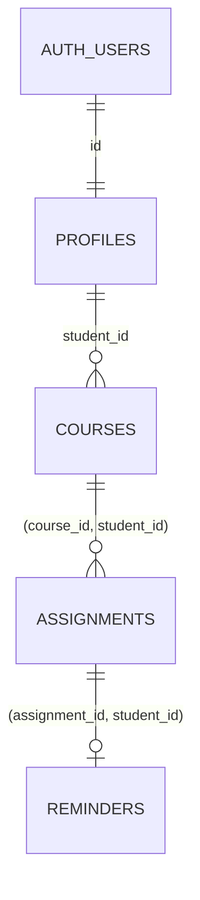

# Consolidated Design: Student Task Tracker

**Status**: Consolidated (Lab 7, step 7). Implementation-level detail for a coding agent.
**Date**: 2026-11-05
**Requirements**: [requirements.md](./requirements.md) · **Architecture**: [architecture.md](./architecture.md)
**Decision**: [docs/decision.md](../decision.md)
**Sources**: [data-model.md](../../specs/001-student-task-tracker/data-model.md) ·
[openapi.yaml](../../specs/001-student-task-tracker/contracts/openapi.yaml) (reference only) ·
[alternative architecture](../architecture-alternative.md) · [reviews](../reviews/)

> **Launch gates (open):** G-1 processor approval / Principle IV amendment; G-2 SC-003 evidence
> from REM-LOAD-1 (§8.4). See [§7.8](#78-production-launch-gate).

---

## 1. Data Model

### 1.1 Decisions

- **`student_id` on every tenant table.** It keeps RLS predicates simple (`student_id = auth.uid()`)
  and fast to index. Consistency is enforced with **composite foreign keys**: an assignment
  references `(course_id, student_id)` on `courses`, so it cannot point at another student's course
  even if a policy were wrong.
- **Profiles** are linked 1:1 to `auth.users(id)`. There is no local password hash.
- **Reminder preferences live on `profiles`.** There are only two settings, so a separate table
  isn't justified.
- **`overdue` is derived**, never stored (FR-007).
- **All timestamps are `timestamptz`**, stored in UTC (FR-020).
- **No audit table** with personal data. Reminder reliability data is kept on the reminder row
  (attempts, timestamps, safe error summary) and deleted after 30 days (PR-3).

### 1.2 Entity relationships



### 1.3 Schema (migration order 0001 → 0006)

```sql
-- 0001_profiles.sql
create table public.profiles (
  id                     uuid primary key references auth.users(id) on delete cascade,
  display_name           text not null check (char_length(display_name) between 1 and 60),
  time_zone              text not null default 'America/Detroit'
                         check (now() at time zone time_zone is not null), -- rejects invalid IANA names
  reminders_enabled      boolean not null default true,
  reminder_lead_minutes  integer not null default 1440
                         check (reminder_lead_minutes between 60 and 10080),
  created_at             timestamptz not null default now()
);
-- trigger on auth.users insert -> insert profiles row from raw_user_meta_data (display_name, time_zone)

-- 0002_courses.sql
create table public.courses (
  id          uuid primary key default gen_random_uuid(),
  student_id  uuid not null references public.profiles(id) on delete cascade,
  name        text not null check (char_length(name) between 1 and 100),
  code        text check (char_length(code) <= 20),
  color       text not null default '#3366CC' check (color ~ '^#[0-9A-Fa-f]{6}$'),
  term        text check (char_length(term) <= 30),
  created_at  timestamptz not null default now(),
  unique (id, student_id)                      -- target of composite FK
);
create index courses_student on public.courses (student_id);

-- 0003_assignments.sql
create type public.assignment_status as enum ('upcoming', 'done');
create table public.assignments (
  id            uuid primary key default gen_random_uuid(),
  student_id    uuid not null,
  course_id     uuid not null,
  title         text not null check (char_length(title) between 1 and 200),
  due_at        timestamptz not null,
  notes         text check (char_length(notes) <= 2000),
  status        public.assignment_status not null default 'upcoming',
  weight        numeric(5,2) check (weight between 0 and 100),
  score         numeric(5,2) check (score between 0 and 100),
  completed_at  timestamptz,
  updated_at    timestamptz not null default now(),
  foreign key (course_id, student_id) references public.courses (id, student_id) on delete cascade,
  unique (id, student_id),
  check ((status = 'done') = (completed_at is not null))
);
create index assignments_student_due on public.assignments (student_id, status, due_at);
create index assignments_course on public.assignments (course_id);

-- 0004_reminders.sql
create type public.reminder_status as enum ('pending', 'processing', 'sent', 'failed', 'cancelled');
create table public.reminders (
  id                    uuid primary key default gen_random_uuid(),
  student_id            uuid not null,
  assignment_id         uuid not null unique,
  send_at               timestamptz not null,
  status                public.reminder_status not null default 'pending',
  attempts              smallint not null default 0 check (attempts between 0 and 3),
  next_attempt_at       timestamptz not null default now(),
  lease_token           uuid,
  lease_expires_at      timestamptz,
  idempotency_key       text not null,           -- 'reminder:' || id || ':' || extract(epoch from send_at)
  provider_message_id   text,
  provider_accepted_at  timestamptz,
  last_error            text check (char_length(last_error) <= 200), -- code only, no PII
  updated_at            timestamptz not null default now(),
  foreign key (assignment_id, student_id)
    references public.assignments (id, student_id) on delete cascade,
  check ((status = 'processing') = (lease_token is not null))
);
create index reminders_due on public.reminders (status, send_at) where status in ('pending', 'processing');

-- 0005_views_functions.sql  (assignments_view, course_averages, reminder triggers,
--                           claim/complete/reconcile, delete_my_account, reminder_metrics)
-- 0006_rls.sql              (enable RLS + policies, revoke/grant on functions)
```

### 1.4 Views

```sql
create view public.assignments_view with (security_invoker = true) as
select a.*, c.name as course_name, c.code as course_code, c.color as course_color,
       (a.status = 'upcoming' and a.due_at < now()) as is_overdue
from public.assignments a join public.courses c on c.id = a.course_id;

create view public.course_averages with (security_invoker = true) as
select c.id as course_id, c.student_id,
       round(sum(a.score * a.weight) filter (where a.score is not null and a.weight > 0)
             / nullif(sum(a.weight) filter (where a.score is not null and a.weight > 0), 0), 1)
         as average,                                   -- null when nothing is graded
       count(*) filter (where a.score is not null and a.weight > 0) as graded_count,
       count(a.id) as total_count,
       coalesce(sum(a.weight), 0) as weight_total,
       coalesce(sum(a.weight), 0) > 100 as weights_over_100
from public.courses c left join public.assignments a on a.course_id = c.id
group by c.id, c.student_id;
```

`security_invoker = true` makes the views respect the caller's RLS.

**Weighted average rule (FR-010)**: average = Σ(score·weight) / Σ(weight) over rows with a score
and weight > 0; rounded half away from zero to 1 decimal; `null` when there are no such rows. Weights
summing to more than 100 still give an average (normalized by Σ weight), and `weights_over_100`
drives the warning. Example: (90·20 + 80·30 + 70·50) / 100 = **77.0**.

### 1.5 Cascades

Deleting `auth.users` → `profiles` → `courses` → `assignments` → `reminders`, all `on delete cascade`.
Deleting a course or assignment cascades to its children. No orphaned rows are possible because
every child FK is `not null`.

## 2. Row-Level Security

All four tables: `alter table … enable row level security;` with **no permissive default**
(deny-by-default). The `anon` role has no grants on any table. Reminder functions are
`revoke all … from public; grant execute … to service_role;`.

### 2.1 Policy predicates

| Table | SELECT | INSERT (WITH CHECK) | UPDATE (USING / WITH CHECK) | DELETE |
|-------|--------|---------------------|-----------------------------|--------|
| profiles | `id = auth.uid()` | none (trigger creates the row as definer) | `id = auth.uid()` / `id = auth.uid()` | none (deleted via `delete_my_account()` cascade) |
| courses | `student_id = auth.uid()` | `student_id = auth.uid()` | same / same | `student_id = auth.uid()` |
| assignments | `student_id = auth.uid()` | `student_id = auth.uid()` **and** composite FK guarantees the course has the same `student_id` | same / same (FK re-checked on `course_id` change) | `student_id = auth.uid()` |
| reminders | `student_id = auth.uid()` (read-only, for status display) | none: only triggers (definer) | none | none (cascade only) |

### 2.2 Access matrix

| Table · operation | Owner (authenticated) | Non-owner (authenticated) | Unauthenticated (`anon`) | Trusted scheduled context (`service_role` via Edge Function) |
|-------------------|-----------------------|---------------------------|--------------------------|----------------------------------------------------------------|
| profiles · S/I/U/D | S, U allowed; I, D denied | all denied (0 rows) | all denied | Bypasses RLS, but only uses reminder functions that read `email`, `reminders_enabled` |
| courses · S/I/U/D | all allowed | all denied | all denied | read-only via function join |
| assignments · S/I/U/D | all allowed | all denied; insert referencing another student's course fails the FK | all denied | read-only via function join |
| reminders · S/I/U/D | S only | all denied | all denied | U via `claim_due_reminders`, `complete_reminder`, `reconcile_reminders` only |

**Service-role bypass.** `service_role` ignores RLS in PostgreSQL. It is therefore held **only** by the
`dispatch-reminders` Edge Function. That function calls only the three reminder functions through
`supabase.rpc`, never `from('table')`. A CI check (SEC-KEY-2) greps the function source to enforce
this. Next.js never has the key (SEC-KEY-1).

**SECURITY DEFINER functions** (`delete_my_account`, the profile-creation trigger, the reminder sync
trigger) set `search_path = ''`, use fully qualified names, and check `auth.uid()` where they act for
a user.

## 3. Reminder Scheduling Logic (database)

```sql
-- Trigger: after insert or update of due_at, status on assignments; after update of
-- reminders_enabled, reminder_lead_minutes on profiles -> calls sync for affected rows.
-- sync(assignment):
--   if status = 'done' or not reminders_enabled or due_at <= now():
--       update reminders set status = 'cancelled', lease_token = null
--         where assignment_id = a.id and status in ('pending', 'processing');
--   else:
--       insert into reminders (student_id, assignment_id, send_at, status, attempts,
--                              next_attempt_at, idempotency_key)
--       values (a.student_id, a.id, a.due_at - lead, 'pending', 0, now(), <key>)
--       on conflict (assignment_id) do update
--         set send_at = excluded.send_at, status = 'pending', attempts = 0,
--             next_attempt_at = now(), lease_token = null, lease_expires_at = null,
--             idempotency_key = excluded.idempotency_key, last_error = null
--         where reminders.status <> 'sent' or reminders.send_at <> excluded.send_at;
```

- If `send_at` is already past but `due_at` is in the future, the row is due immediately and goes
  out on the next tick (FR-008).
- A `sent` reminder is re-armed only if the due time **changes** (new `send_at`, new idempotency
  key). Undoing done on an already-reminded assignment does not send a second email.
- `reschedule_student_reminders(student_id)` runs the sync for all of a student's upcoming
  assignments; it is called by the profile trigger.

## 4. Server Action Contracts

Server Actions are **internal web interfaces, not a versioned public API**. Each action is a typed
function in `app/actions/*.ts`, validates input with a shared Zod schema in `lib/contracts/*.ts`, and
returns:

```ts
type ActionResult<T> =
  | { ok: true; data: T }
  | { ok: false; error: { code: 'VALIDATION' | 'UNAUTHENTICATED' | 'NOT_FOUND' | 'CONFLICT' | 'RATE_LIMITED' | 'INTERNAL';
                          message: string;                         // safe, user-facing
                          fieldErrors?: Record<string, string[]> } };
```

`NOT_FOUND` is also returned for rows owned by another student. RLS returns zero rows, so the action
never reveals that the row exists. No action returns secrets, password material or auth tokens.
`INTERNAL` errors are logged with a request ID only.

| Action | Auth | Input (Zod) | Success `data` | Errors | Side effects / transaction | Tests |
|--------|------|-------------|----------------|--------|----------------------------|-------|
| `signUp` | none | `email` (email), `password` (min 8, max 72), `displayName` (1–60), `timeZone` (valid IANA) | `{ status: 'check-email' }` (always) | VALIDATION, RATE_LIMITED | Supabase `auth.signUp`; trigger creates profile | ACT-AUTH-1 |
| `signIn` | none | `email`, `password`, `redirectTo?` (relative path) | `{ redirect: string }` | VALIDATION, UNAUTHENTICATED (generic message), RATE_LIMITED | Sets session cookie | ACT-AUTH-2 |
| `signOut` | user | — | `{}` | — | Clears session | ACT-AUTH-3 |
| `requestPasswordReset` | none | `email` | `{ status: 'check-email' }` (always) | VALIDATION, RATE_LIMITED | Supabase reset email | ACT-AUTH-4 |
| `completePasswordReset` | reset code | `code`, `newPassword` | `{}` | VALIDATION, UNAUTHENTICATED | Supabase `updateUser` | ACT-AUTH-5 |
| `getProfile` | user | — | `Profile` (no email change, no secrets) | UNAUTHENTICATED | — | ACT-PROFILE-1 |
| `updateProfile` | user | `displayName?`, `timeZone?` | `Profile` | VALIDATION | Update profiles | ACT-PROFILE-1 |
| `updateReminderSettings` | user | `remindersEnabled?`, `reminderLeadMinutes?` (60–10080) | `Profile` | VALIDATION | One transaction: update profile → trigger reschedules/cancels all reminders | ACT-PROFILE-2, REM-4 |
| `createCourse` | user | `name` (1–100), `code?` (≤20), `color?` (hex), `term?` (≤30) | `Course` | VALIDATION | Insert | ACT-COURSE-1 |
| `updateCourse` | user | `id` (uuid) + any of the above | `Course` | VALIDATION, NOT_FOUND | Update | ACT-COURSE-2 |
| `deleteCourse` | user | `id`, `confirm: true` | `{ deletedAssignments: number }` | NOT_FOUND, CONFLICT (if `confirm` missing and assignments exist) | Delete; cascade to assignments and reminders in one statement | ACT-COURSE-3/4 |
| `listCourses` | user | — | `CourseWithAverage[]` (joins `course_averages`) | — | — | ACT-COURSE-1 |
| `createAssignment` | user | `courseId`, `title` (1–200), `dueLocal` (ISO local date-time), `notes?` (≤2000), `weight?` (0–100), `score?` (0–100) | `Assignment` | VALIDATION, NOT_FOUND (course) | Insert (local → UTC via profile time zone); trigger creates reminder | ACT-ASG-1/2, REM-11 |
| `updateAssignment` | user | `id` + any field above | `Assignment` | VALIDATION, NOT_FOUND | Update; trigger reschedules reminder on `due_at` change | ACT-ASG-3/4, REM-12 |
| `setAssignmentStatus` | user | `id`, `status: 'upcoming' \| 'done'` | `Assignment` | NOT_FOUND | Update status + `completed_at`; trigger cancels or re-arms reminder | ACT-ASG-7, REM-13/14 |
| `deleteAssignment` | user | `id` | `{}` | NOT_FOUND | Delete; reminder cascades | ACT-ASG-5, REM-15 |
| `listAssignments` | user | `courseId?`, `status?: 'upcoming' \| 'overdue' \| 'done'`, `fromLocal?`, `toLocal?` | `AssignmentView[]` sorted by `due_at` asc | VALIDATION | Read `assignments_view` | ACT-ASG-6, DB-VIEW-1/2 |
| `getCourseAverage` | user | `courseId` | `{ average: number \| null, gradedCount, totalCount, weightsOver100 }` | NOT_FOUND | Read `course_averages` | DB-AVG-1..4 |
| `deleteAccount` | user | `password` (re-auth), `confirm: 'DELETE'` | `{}` → redirect to `/` | VALIDATION, UNAUTHENTICATED | Re-authenticate, then `rpc('delete_my_account')`; cascade; sign out | ACT-ACCT-1, DB-CASCADE-1 |

**Scheduled entry points** (Edge Function, not Server Actions):

| Entry | Caller | Auth | Input | Output | Tests |
|-------|--------|------|-------|--------|-------|
| `POST /functions/v1/dispatch-reminders` | Supabase Cron, every minute | `Authorization: Bearer CRON_SECRET` (constant-time compare) | none | `{ claimed, sent, retried, failed, durationMs }` | SEC-CRON-1, REM-5..10 |
| `POST /functions/v1/dispatch-reminders?mode=reconcile` | Supabase Cron, daily 03:17 UTC | same | none | `{ created, cancelled, stuck }` | REM-16 |
| `cleanup_old_reminders()` (SQL) | Supabase Cron, daily | runs as job owner | none | rows deleted (status in sent/failed/cancelled and older than 30 days) | DB-RET-1 |

## 5. Reminder State Machine

### 5.1 States and transitions

```mermaid
stateDiagram-v2
  [*] --> pending: assignment created / due changed / undo / reminders on
  pending --> processing: claim (send_at and next_attempt_at reached; attempts+1; lease 120 s)
  processing --> sent: provider 2xx (store message id, accepted_at)
  processing --> pending: retryable error and attempts < 3 (next_attempt_at = now + 60 s, then 120 s)
  processing --> failed: permanent error, or retryable error and attempts = 3
  processing --> processing: lease expired, re-claimed by a later run (attempts+1)
  pending --> cancelled: done / deleted / reminders off / due passed
  processing --> cancelled: pre-send check finds done or disabled
  sent --> pending: due time edited (new send_at, new key)
  failed --> pending: due time edited
  cancelled --> pending: undo / reminders on / due edited (if due in future)
  sent --> [*]
  failed --> [*]
  cancelled --> [*]
```



### 5.2 `claim_due_reminders(p_batch int, p_lease_seconds int)`
In one transaction:
1. Select up to `p_batch` reminders where (`status = 'pending'` and `send_at <= now()` and
   `next_attempt_at <= now()`) or (`status = 'processing'` and `lease_expires_at < now()`), ordered by
   `send_at`, `FOR UPDATE SKIP LOCKED`.
2. Join assignment, course, profile and `auth.users.email`. Rows whose assignment is `done`, whose
   profile has reminders off, or whose `due_at <= now()` → set `cancelled` and do not return them.
3. Rows whose `attempts = 3` and lease expired → `failed` (`last_error = 'LEASE_EXPIRED_MAX'`).
4. Remaining rows → `status = 'processing'`, `lease_token = gen_random_uuid()`,
   `lease_expires_at = now() + p_lease_seconds`, `attempts = attempts + 1`.
5. Return `id, lease_token, idempotency_key, email, title, course label, due_at, time_zone`. These
   are the only fields the email needs (FR-018).

### 5.3 `complete_reminder(p_id, p_lease_token, p_outcome, p_message_id, p_error_code)`
Applies only if `lease_token = p_lease_token` (otherwise no-op, returns false):
- `sent` → `status = 'sent'`, `provider_message_id`, `provider_accepted_at = now()`, clear lease.
- `retryable` → if `attempts < 3`: `status = 'pending'`,
  `next_attempt_at = now() + (60 * attempts) seconds`; else `failed`. Clear lease.
- `permanent` → `failed`, `last_error = p_error_code`. Clear lease.

**Error classification** (adapter): 2xx → sent; 409 `concurrent_idempotent_requests`, 429, 5xx,
network timeout (10 s) → retryable; 409 `invalid_idempotent_request`, 400, 401, 403, 422 → permanent
(401/403 also raise an operator alert).

### 5.4 Races and guarantees
- **Two overlapping runs**: `SKIP LOCKED` + lease means each row is claimed by one run at a time.
- **Run dies after sending, before `complete_reminder`**: the lease expires after 120 s; the next run
  re-claims and resends with the **same idempotency key**; Resend returns the original response
  without a second email (keys kept 24 h).
- **Student marks done during the send window**: claim re-checks status, so the remaining window is
  claim → provider call, typically under 10 s. If done lands inside that window, one reminder may
  still be sent. This residual risk is accepted and documented.
- **Strongest guarantee**: at-least-once processing with provider de-duplication inside 24 hours.
  Exactly-once delivery is **not** promised.

### 5.5 Edge Function outline (`supabase/functions/dispatch-reminders/index.ts`)

```ts
Deno.serve(async (req) => {
  if (!timingSafeEqual(bearer(req), Deno.env.get('CRON_SECRET'))) return json(401, {});
  const deadline = Date.now() + 45_000;
  const stats = { claimed: 0, sent: 0, retried: 0, failed: 0 };
  for (let batch = 0; batch < 5 && Date.now() < deadline; batch++) {
    const { data: rows } = await admin.rpc('claim_due_reminders', { p_batch: 100, p_lease_seconds: 120 });
    if (!rows?.length) break;
    stats.claimed += rows.length;
    await pool(rows, 10, async (r) => {
      const result = await email.sendReminder(renderReminder(r), r.idempotency_key); // adapter
      await admin.rpc('complete_reminder', { p_id: r.id, p_lease_token: r.lease_token, ...result.toDb() });
      stats[result.statKey]++;
    });
  }
  log({ event: 'dispatch', ...stats, durationMs }); // no personal data
  return json(200, stats);
});
```

## 6. Time Zones

- `lib/domain/time.ts`: `toUtc(localIso, tz)` and `fromUtc(instant, tz)` using `Temporal` (polyfill)
  or `date-fns-tz`. Never use fixed offsets.
- Non-existent local times (spring-forward gap) are rejected with `VALIDATION` ("This time doesn't
  exist on that date because of daylight saving"); ambiguous times (fall-back) resolve to the
  **earlier** instant.
- Calendar weeks run Monday 00:00 to next Monday 00:00 in the student's zone, converted to a UTC range.
- Reminder email shows the due time in the student's zone with its abbreviation (for example,
  "Nov 12, 11:59 PM EST").

## 7. Deployment and Environments

### 7.1 Environments

| Env | Vercel | Supabase project | Email | Data |
|-----|--------|------------------|-------|------|
| local | `next dev` | `supabase start` (Docker) | Mailpit (bundled with Supabase local) | seed script, synthetic |
| preview | per-PR preview deployment | `tracker-preview` (shared, reset weekly) or Supabase branching if available on the plan | Resend test mode / sandbox domain | synthetic seed |
| production | production deployment | `tracker-prod` | Resend, verified domain | real student data **only after G-1 and G-2 close** |

Preview deployments never get production keys (Vercel environment variable scoping).

### 7.2 Migrations
`supabase/migrations/*.sql` is the single source of truth for schema, RLS, views, functions,
triggers and cron jobs. CI applies migrations to a fresh local database and runs pgTAP. After merge to
`main`, a GitHub Actions job runs `supabase db push` to preview, then to production after a manual
approval. **Forward-fix only** in production: destructive changes use expand → migrate → contract
across releases.

### 7.3 Scheduled jobs (Supabase Cron)

```sql
select cron.schedule('dispatch-reminders', '* * * * *', $$
  select net.http_post(
    url     := (select decrypted_secret from vault.decrypted_secrets where name = 'dispatch_url'),
    headers := jsonb_build_object('Authorization',
                 'Bearer ' || (select decrypted_secret from vault.decrypted_secrets where name = 'cron_secret')),
    timeout_milliseconds := 55000);
$$);
select cron.schedule('reconcile-reminders', '17 3 * * *', $$ /* same, ?mode=reconcile */ $$);
select cron.schedule('cleanup-reminders',  '41 3 * * *', $$ select public.cleanup_old_reminders(); $$);
```

Frequency: 1 minute. Batch: 100, at most 5 batches or 45 s per run. Lease: 120 s. Retries: 3 total
attempts. **Verify before launch** that the chosen Supabase plan allows pg_cron/pg_net at this
frequency and that Edge Function invocation quotas cover about 44,000 calls per month.

### 7.4 Email
`lib/email/adapter.ts` interface: `sendReminder(msg, idempotencyKey): Promise<SendResult>`.
`ResendAdapter` sets the `Idempotency-Key` header. `MailpitAdapter` (SMTP) is used locally.
Template fields: title, course label, local due time, link to the assignment. **No notes, scores or
weights** (UNIT-EMAIL-1).

### 7.5 CI (GitHub Actions, required checks)
`lint` · `typecheck` · `unit` · `db-test` (supabase start + migrations + pgTAP) · `actions-test` ·
`e2e` (Playwright + axe against local stack) · `secret-scan` (bundle + repo) · `migration-dry-run`.
Branch protection on `main`: all required checks green, one approving review, no direct pushes.

### 7.6 Secrets

| Secret | Where | Who can read |
|--------|-------|--------------|
| `NEXT_PUBLIC_SUPABASE_URL`, `NEXT_PUBLIC_SUPABASE_ANON_KEY` | Vercel env | Public by design |
| `SUPABASE_SERVICE_ROLE_KEY` | Supabase Edge Function secrets | Edge Function only |
| `CRON_SECRET` | Supabase Vault + Edge Function secrets | Cron job, Edge Function |
| `RESEND_API_KEY` | Supabase Edge Function secrets | Edge Function only |
| `SUPABASE_DB_PASSWORD`, `SUPABASE_ACCESS_TOKEN` | GitHub Actions secrets (environment-scoped) | Migration job only |

Rotation: each term, on team change, and immediately after suspected exposure.

### 7.7 Backups, monitoring, ownership
- Backups: Supabase daily backups. A **restore drill** into a scratch project before launch and once
  per term, with the time to restore recorded.
- Alerts (§6.4 of architecture): oldest pending reminder > 3 min; no successful dispatch in 5 min;
  any `failed`; p99 delay (24 h) > 4 min; 80 % of any plan quota. Alerts go to the project owner's
  email.
- Ownership: project owner (Reimond Mullalli) for operations, secrets and incident response in v1.

### 7.8 Production launch gate
Production may accept real student data only when **all** are true:
1. **G-1**: processor review (PR-5) recorded in `docs/` **and** either an approved processor
   exception or a merged Principle IV amendment PR.
2. **G-2**: REM-LOAD-1 report shows p99 `provider_accepted_at − send_at` ≤ 5 min with ≥ 2,000
   reminders, including failure injection.
3. PERF-1 shows p95 < 2 s; all CI checks green; restore drill done; plan limits verified (R-5).

## 8. Test Plan

All tests are written **before** the code they cover and must fail first (Red-Green-Refactor).

### 8.1 Database tests (pgTAP, `supabase/tests/`)

| ID | What |
|----|------|
| DB-RLS-PROFILES, DB-RLS-COURSES, DB-RLS-ASSIGNMENTS, DB-RLS-REMINDERS | For each table and each of S/I/U/D: owner allowed per §2.1; **non-owner gets 0 rows / error**; **anon denied**; forged `student_id` on insert rejected; update that changes `student_id` rejected |
| DB-RLS-XREF | Inserting or updating an assignment with another student's `course_id` fails (composite FK) |
| DB-FN-GRANTS | `claim_due_reminders`, `complete_reminder`, `reconcile_reminders` not executable by `authenticated` or `anon` |
| DB-CHK-1 | Title length, weight/score 0–100, color format, lead 60–10,080, invalid time zone rejected |
| DB-VIEW-1 | `assignments_view` sorted by `due_at` and respects RLS (security_invoker) |
| DB-VIEW-2 | `is_overdue` true only for upcoming + past due |
| DB-AVG-1 | 90/80/70 × 20/30/50 → 77.0 |
| DB-AVG-2 | No graded assignments → null |
| DB-AVG-3 | Weights 60 + 60 → average computed, `weights_over_100 = true` |
| DB-AVG-4 | Ungraded and weight-0 rows excluded |
| DB-CASCADE-1 | `delete_my_account()` removes auth user, profile, courses, assignments, reminders; another student's data untouched |
| DB-RET-1 | Cleanup deletes only finished reminders older than 30 days |

### 8.2 Reminder tests (database functions + Edge Function with a fake adapter)

| ID | What |
|----|------|
| REM-1 | Create assignment → one `pending` reminder with `send_at = due − lead` |
| REM-2 | Due in the past → no reminder |
| REM-3 | `send_at` past, due future → claimed on next run |
| REM-4 | Reminders off → all pending cancelled; on → re-armed for future-due upcoming assignments |
| REM-5 | Two concurrent `claim_due_reminders` calls return disjoint rows |
| REM-6 | Retryable error → `pending` with backoff 60 s then 120 s; 3rd failure → `failed` |
| REM-7 | Permanent error → `failed` immediately |
| REM-8 | Lease expiry → re-claimed with the same idempotency key; fake provider records one send |
| REM-9 | Stale `complete_reminder` with an old lease token is a no-op |
| REM-10 | Missed runs: 30 min of due reminders all sent on the next run, batches respected |
| REM-11..15 | Create, due edit, done, undo, delete each produce the correct reminder state |
| REM-16 | Reconciliation creates missing reminders and cancels stale ones |
| SEC-CRON-1 | Dispatch without, or with a wrong, `CRON_SECRET` → 401, no rows claimed |

### 8.3 Unit, action and end-to-end tests

| ID | What |
|----|------|
| UNIT-TZ-1..3 | Local↔UTC conversion; spring-forward gap rejected; fall-back resolves earlier |
| UNIT-AVG-1 | Client display formatting of averages (1 decimal, "No grades yet") |
| UNIT-EMAIL-1 | Rendered email contains title, course, local due time; **does not contain notes, score or weight** |
| ACT-AUTH-1..5, ACT-PROFILE-1..2, ACT-COURSE-1..4, ACT-ASG-1..7, ACT-ACCT-1 | One contract test per action: valid input → schema-valid output; invalid input → VALIDATION with `fieldErrors`; side effects as in §4 |
| ACT-SEC-1..3 | As student B: read, update and delete student A's course/assignment by ID → NOT_FOUND, data unchanged |
| ACT-VAL-1 | Error responses never include stack traces, SQL or other students' data |
| SEC-KEY-1 | Built `.next/` output contains no service-role key or `RESEND_API_KEY` |
| SEC-KEY-2 | Edge Function source uses only `rpc()` for the three reminder functions |
| E2E-AUTH-1, E2E-AUTH-2 | E2E-AUTH-1: sign-up/in/out; E2E-AUTH-2: password reset via Mailpit |
| E2E-US1 | Add courses and assignments, sort order, mark done/undo, overdue, filters |
| E2E-US2 | Lead 1 h, assignment due in 61 min with a test clock → one Mailpit message; done first → none |
| E2E-US3 | Enter grades → 77.0 %; over-100 warning |
| E2E-US4 | Calendar placement, colors with course codes, week navigation |
| E2E-A11Y-1 | axe: no serious/critical violations on every page; keyboard-only flow for US1 |

### 8.4 Reminder load and failure test (REM-LOAD-1)

Environment: preview Supabase project + deployed Edge Function + Resend test mode (or a mock HTTP
provider with 200–800 ms latency).
1. Seed 2,000 reminders with `send_at` spread across 60 minutes, with 30 % clustered in one minute.
2. During the run, inject 5 % provider 5xx for 10 minutes, kill one function run mid-batch, and
   trigger 3 overlapping manual invocations.
3. Compute `percentile_cont(0.99) within group (order by provider_accepted_at - send_at)`, counting
   `failed` rows as misses.
4. **Pass**: p99 ≤ 5 min, zero duplicate provider sends (fake provider log), no stuck `processing`
   rows after 10 minutes.

### 8.5 Performance (PERF-1)
Seed one student with 8 courses and 500 assignments. Measure 200 loads of the dashboard and calendar
on the preview deployment. **Pass**: p95 < 2 s (server response + render).

### 8.6 Usability (SC-001, SC-005)
Moderated sessions with ≥ 10 students who are new to the app: time to the first course and assignment
(SC-001), and first-try success on "add an assignment and mark it done" (SC-005). Results are recorded
in `docs/usability/`. Automated tests are **not** counted as usability evidence.

## 9. Constitution Check (consolidated)

| Principle | Status | Evidence |
|-----------|--------|----------|
| I. Simplicity | PASS | No API server, Redis or worker; complexity limited to the reminder lease, which is required by FR-014 |
| II. Spec-driven | PASS | Requirements → architecture → design with traceability (requirements §8) |
| III. Test-first | **PASS with interpretation**: contract test per Server Action replaces "per endpoint"; to be recorded in the G-1 constitution PR | §8 |
| IV. Privacy & security | **OPEN – BLOCKING (G-1)**: third-party processors conflict with "no personal data shared with third parties" | requirements §6 |
| V. CI & version control | PASS | §7.5 |
